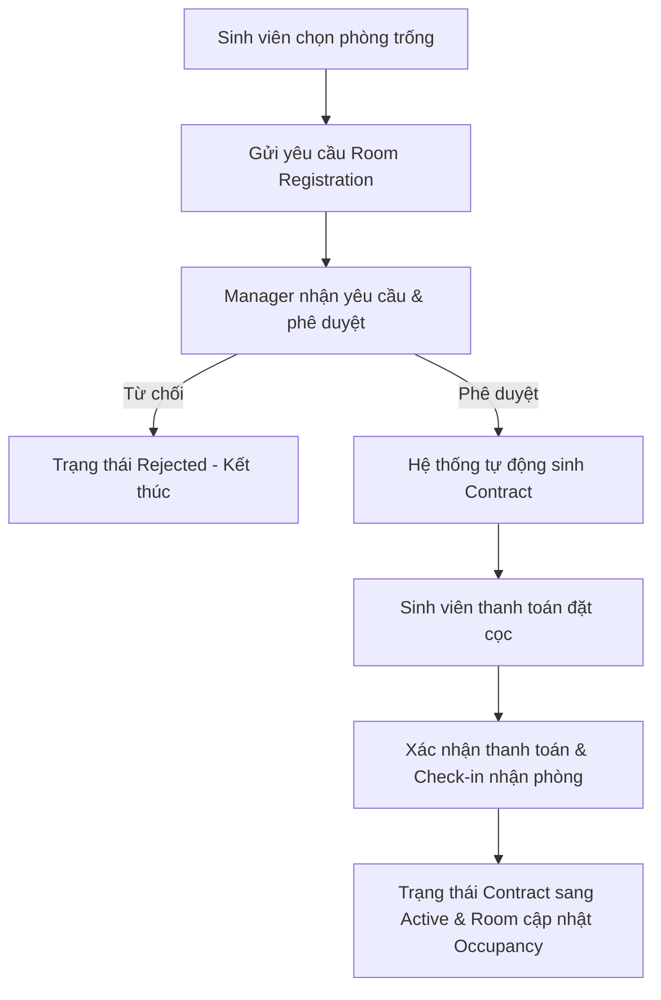
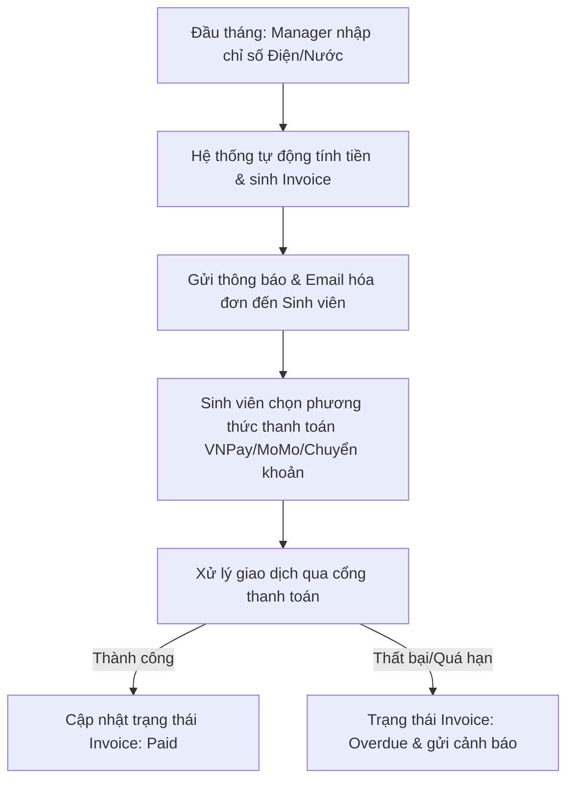
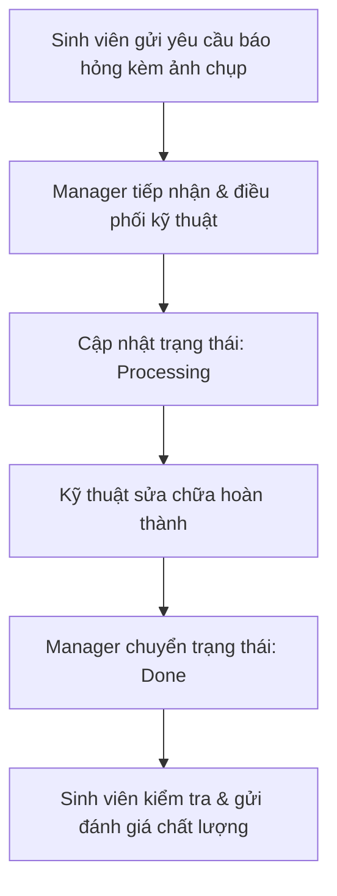

# DormHub - Smart Dormitory Management System (Frontend)

## 📌 Giới thiệu dự án
DormHub là hệ thống quản lý ký túc xá thông minh dành cho sinh viên, quản lý ký túc xá và quản trị viên hệ thống. Dự án Frontend được phát triển bằng **React**, **Vite** và **Tailwind CSS v4**, mang lại giao diện hiện đại, mượt mà và trực quan.

---

## 🚀 Công nghệ sử dụng (Frontend Stack)
- **Framework & Build tool**: React 19, Vite 8
- **Routing**: React Router v7
- **Styling & UI**: Tailwind CSS v4, Base UI, Shadcn, Motion (Framer Motion), tw-animate-css
- **State Management & Data Fetching**: React Context, TanStack Query (tùy chọn)
- **Forms & Validation**: React Hook Form, Zod/Yup
- **Charts & Statistics**: Recharts
- **API Client**: Axios
- **Utilities**: Day.js, Lucide React (Icons), Sonner (Toasts)

---

## 📂 Cấu trúc thư mục (`src/`)
Chi tiết cấu trúc thư mục của dự án Frontend:
```text
src/
├── api/          # Cấu hình Axios client, interceptors và các API call chính
├── assets/       # Tài nguyên tĩnh: hình ảnh, logo, v.v.
├── components/   # Các UI component dùng chung (Buttons, Input, Modals, Cards,...)
├── constants/    # Khai báo các hằng số (role, status, API endpoints,...)
├── context/      # Quản lý global state (AuthContext, ThemeContext,...)
├── hooks/        # Các Custom Hook tái sử dụng (useAuth, useLocalStorage,...)
├── layouts/      # Layout chung cho từng vai trò (AdminLayout, ManagerLayout, StudentLayout, AuthLayout)
├── lib/          # Cấu hình các thư viện bên thứ 3 (Shadcn, Axios instance,...)
├── pages/        # Các view/page chính của hệ thống chia theo vai trò và chức năng
├── routes/       # Cấu hình định tuyến (routes.jsx, ProtectedRoutes,...)
├── schemas/      # Định nghĩa các schema validation (Zod/Yup cho forms)
├── services/     # Tương tác với backend (authService, roomService, invoiceService,...)
├── utils/        # Các hàm tiện ích dùng chung (format tiền tệ, ngày tháng,...)
├── App.jsx       # Entry component chính điều hướng ứng dụng
├── App.css       # Style global bổ sung cho ứng dụng
├── index.css     # Entry stylesheet chứa cấu hình Tailwind CSS v4
└── main.jsx      # Điểm khởi chạy React app
```

---

## 👥 Các vai trò & Tính năng trên Frontend

### 1. Sinh viên (Student)
- **Đăng ký & Đăng nhập**: 
  - Đăng ký tài khoản mới và xác thực qua mã OTP gửi tới Email.
  - Đăng nhập hệ thống (hỗ trợ JWT Token, Refresh Token, Google Login tích hợp).
  - Đổi mật khẩu & khôi phục mật khẩu qua luồng Quên mật khẩu.
- **Quản lý hồ sơ cá nhân**: 
  - Xem và cập nhật thông tin cá nhân: Họ tên, MSSV, CCCD, Trường, Khoa, Lớp, Giới tính, Ngày sinh, Ảnh đại diện, Địa chỉ, SĐT, Email.
  - Quản lý thông tin liên hệ khẩn cấp (Họ tên, SĐT, Quan hệ).
- **Đăng ký thuê phòng (Room Registration)**: 
  - Xem danh sách phòng trống kèm bộ lọc (Tòa nhà, Tầng, Sức chứa, Loại phòng, Giá cả, Tiện ích, Giới tính).
  - Gửi yêu cầu đăng ký phòng trực tuyến.
- **Hợp đồng & Gia hạn**: 
  - Xem thông tin chi tiết hợp đồng thuê phòng hiện tại (Ngày bắt đầu, Ngày kết thúc, Tiền cọc, Tiền phòng hàng tháng, Trạng thái).
  - Gửi yêu cầu gia hạn hợp đồng.
- **Hóa đơn & Thanh toán**: 
  - Xem hóa đơn hàng tháng chi tiết (Tiền phòng, Tiền điện, Tiền nước, Internet, Phí dịch vụ gửi xe, v.v.).
  - Thanh toán hóa đơn và tiền đặt cọc bằng nhiều phương thức: VNPay, MoMo, Chuyển khoản (Bank Transfer), Tiền mặt (Cash).
- **Báo hỏng & Bảo trì (Maintenance)**: 
  - Tạo yêu cầu báo hỏng cơ sở vật chất kèm mô tả chi tiết, độ ưu tiên (Low, Medium, High, Urgent) và tải lên hình ảnh lỗi (tích hợp Cloudinary).
  - Xem tiến độ xử lý và gửi đánh giá (rating/phản hồi) khi hoàn thành.
- **Chat & Hỗ trợ**: Chat trực tiếp với Quản lý tòa nhà (Manager) thời gian thực bằng WebSocket.
- **Thông báo**: Nhận thông báo đẩy/tức thời về hóa đơn mới, hóa đơn quá hạn, trạng thái hợp đồng, cập nhật báo hỏng.

### 2. Quản lý ký túc xá (Dorm Manager)
- **Quản lý cơ sở vật chất**: Xem, cập nhật trạng thái phòng nghỉ trong các tòa nhà theo sơ đồ: `Building -> Floor -> Room`.
- **Duyệt đăng ký phòng**: Tiếp nhận, kiểm tra hồ sơ và phê duyệt (Approved) hoặc từ chối (Rejected) các yêu cầu thuê phòng từ sinh viên.
- **Quản lý hợp đồng**: 
  - Tạo hợp đồng tự động khi duyệt đăng ký thành công.
  - Hỗ trợ quy trình Check-in và Check-out (tính tiền còn thiếu, hoàn trả cọc, giải phóng phòng thành Available).
- **Ghi chỉ số điện nước (Meter Reading)**: Nhập chỉ số cũ và mới của Điện/Nước mỗi tháng, hệ thống tự động tính số lượng tiêu thụ và thành tiền.
- **Quản lý hóa đơn & Công nợ**: 
  - Tạo hóa đơn hàng tháng và gửi email/thông báo nhắc nợ tự động đến sinh viên.
  - Quản lý trạng thái hóa đơn (Pending, Paid, Overdue, Canceled).
- **Xử lý báo hỏng**: Tiếp nhận các phản hồi báo hỏng, cập nhật trạng thái xử lý (Processing -> Done).
- **Gửi thông báo**: Gửi tin nhắn, thông báo chung đến toàn bộ tòa nhà hoặc các tầng cụ thể.

### 3. Quản trị viên (Admin)
- **Quản lý tài khoản (User Management)**: Thêm, sửa, xóa, khóa tài khoản người dùng trong hệ thống.
- **Phân quyền (RBAC)**: Định cấu hình Roles (ADMIN, MANAGER, STUDENT) và Permissions cho từng nhóm người dùng.
- **Quản lý Tòa nhà & Cơ sở vật chất**: Quản lý danh mục các Tòa nhà (Buildings), cấu hình thông số cơ bản.
- **Sao lưu dữ liệu**: Thực hiện Backup & Restore cơ sở dữ liệu để đảm bảo an toàn thông tin.
- **Dashboard phân tích**: Dashboard tổng quan hiển thị doanh thu, tỷ lệ lấp đầy phòng, thống kê công nợ, số lượng sinh viên hoạt động qua các biểu đồ trực quan (Recharts).

---

## 🛠️ Quy trình nghiệp vụ cốt lõi trên Frontend

### 1. Quy trình đăng ký thuê phòng


### 2. Quy trình hóa đơn & thanh toán hàng tháng


### 3. Quy trình báo hỏng thiết bị


---

## ⚙️ Hướng dẫn cài đặt và khởi chạy dự án dưới Local

### 1. Yêu cầu hệ thống
- **Node.js**: Phiên bản 18 hoặc mới hơn.
- **npm** (được cài đặt sẵn cùng Node.js).

### 2. Cài đặt các thư viện phụ thuộc
Truy cập vào thư mục `FE` và chạy lệnh cài đặt:
```bash
npm install
```

### 3. Cấu hình biến môi trường (`.env`)
Tạo file `.env` tại thư mục gốc của Frontend và cấu hình các biến sau:
```env
VITE_API_BASE_URL=http://localhost:8080/api/v1
VITE_WS_URL=ws://localhost:8080/ws
VITE_CLOUDINARY_UPLOAD_PRESET=your_upload_preset
VITE_CLOUDINARY_CLOUD_NAME=your_cloud_name
```

### 4. Khởi chạy Local Development Server
Để bắt đầu code và xem thay đổi trực tiếp trên trình duyệt, chạy:
```bash
npm run dev
```
Mặc định ứng dụng sẽ chạy tại: [http://localhost:5173](http://localhost:5173)

### 5. Build ứng dụng cho môi trường Production
Để build tối ưu mã nguồn cho việc deploy thực tế, chạy:
```bash
npm run build
```
Mã nguồn đã được build sẽ nằm trong thư mục `dist/`.

---

## 🔒 Cơ chế phân quyền và bảo vệ định tuyến (Routing & Guard)
Frontend sử dụng **React Router v7** để cấu hình phân quyền thông minh:
- **Public Routes**: Trang đăng ký, đăng nhập, quên mật khẩu được cấu hình để chuyển hướng người dùng đã xác thực ra màn hình chính.
- **Private Routes**: Sử dụng Component bọc để kiểm tra JWT Access Token hợp lệ và khớp với phân quyền truy cập:
  - Sinh viên chỉ có quyền truy cập các màn hình dưới `/student/*`.
  - Quản lý chỉ có quyền truy cập các màn hình dưới `/manager/*`.
  - Admin có quyền truy cập toàn bộ trang quản trị dưới `/admin/*`.
- **Layouts**: Tách biệt rõ ràng bố cục giao diện (Sidebar, Header, Content Area) của từng đối tượng sử dụng để tối ưu hóa trải nghiệm người dùng.

---
*Dự án được xây dựng và phát triển bởi đội ngũ DormHub.*
